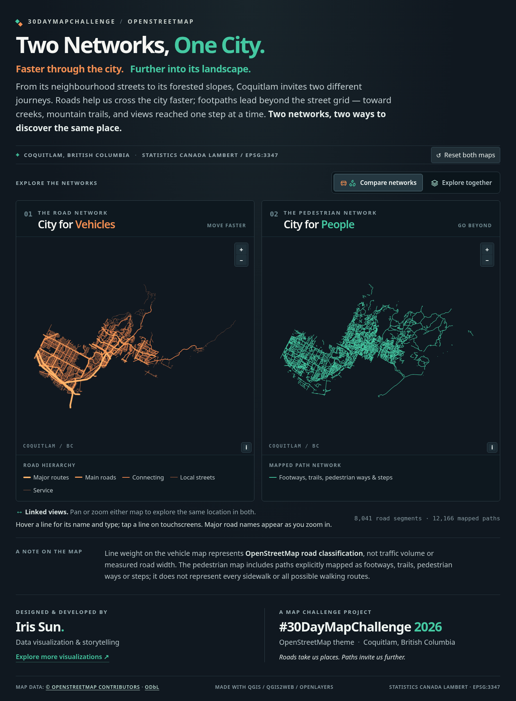
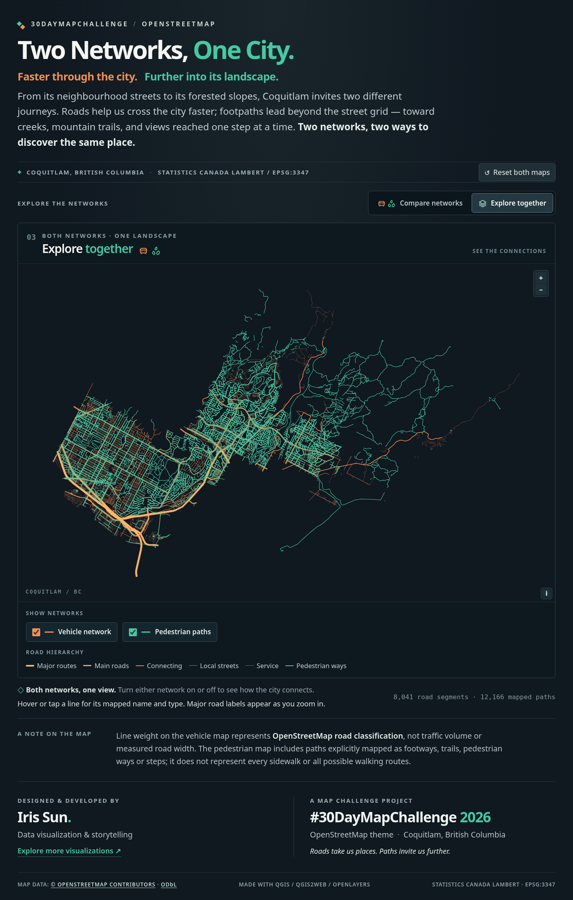

# Two Networks, One City — Coquitlam, BC | Version 2

**Faster through the city. Further into its landscape.**

An interactive 2026 **#30DayMapChallenge / OpenStreetMap** visualization, designed and developed by **Iris Sun**. It contrasts Coquitlam’s road network with mapped pedestrian paths, from neighbourhood streets toward parks, forested slopes and mountain trails.

## What’s in Version 2

- **Compare networks (default):** two side-by-side synchronized maps, one for vehicle roads and one for mapped pedestrian paths
- **Explore together:** a larger single map showing the two networks overlaid, with separate show/hide controls; its initial view fits the larger canvas
- Graduated road weights based on OpenStreetMap road classifications, major-road labels at closer zoom levels, and name/type hover or tap tooltips
- Responsive desktop/mobile design, matching map navigation, original storytelling and credits
- **Statistics Canada Lambert (EPSG:3347)**, with OpenLayers and Proj4 packaged locally (no external tile service or CDN required)

## Publish as a NEW GitHub Pages site (keep Version 1 untouched)

1. On GitHub, create a **new public repository** named `coquitlam-two-networks-v2`. Do **not** edit, rename, delete or upload files to `coquitlam-two-networks` (your V1 repository).
2. Extract `Coquitlam_Two_Networks_V2_GitHub_Pages.zip` on your computer.
3. Open the *extracted folder*, select **all its contents** (including `index.html`, `vehicles.js`, `walking.js`, `ol.js`, `proj4.js`, `ol.css`, `.nojekyll`, and the documents), and upload them to the **root of the new V2 repository**. Do not upload a ZIP into the repository or put all website files under another folder.
4. Commit the new files to the `main` branch.
5. Go to **Settings → Pages → Build and deployment**. Set Source to **Deploy from a branch**, choose branch **main**, folder **/(root)**, then Save.
6. After deployment completes, open:

   `https://missun88-bot.github.io/coquitlam-two-networks-v2/`

7. Check **Compare networks** (the default), switch to **Explore together**, try the road/path checkboxes, zoom/pan, road labels, tooltips, and then switch back.

**V1 remains at:** https://missun88-bot.github.io/coquitlam-two-networks/ — it is entirely separate and is not part of this deployment.

## Files

All runtime files sit at repository root. This is intentional: `index.html` references `ol.css`, `proj4.js`, `ol.js`, `vehicles.js`, and `walking.js` directly. Page-specific CSS and JavaScript are bundled inside `index.html` so the view selector and matching map logic deploy together.

`preview-compare.png` and `preview-together.png` are optional screenshots used in this README. `DATA_LICENSE.md` documents OSM reuse obligations; `THIRD_PARTY_NOTICES.md` covers bundled libraries. `.nojekyll` disables Jekyll processing.

## Credits and caveats

**Designer and developer:** Iris Sun. **Mapping tools:** QGIS, QuickOSM, qgis2web, OpenLayers, Proj4js. **Geographic data:** © OpenStreetMap contributors, ODbL 1.0. **Projection:** Statistics Canada Lambert / EPSG:3347.

Line width shows road *classification*, not measured speed, width or traffic. The pedestrian network includes paths recorded in OSM and is not a complete inventory of every sidewalk or legally accessible walking route. Names appear only where recorded in OSM.

This release builds on the previously tested V2.2 implementation but is packaged and documented as a separate **Version 2 website**. No changes have been made to the V1 GitHub repository.
